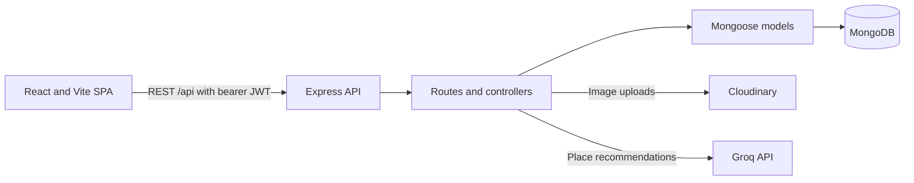
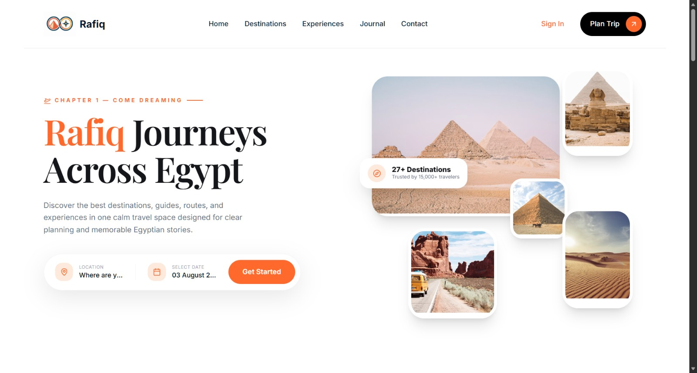
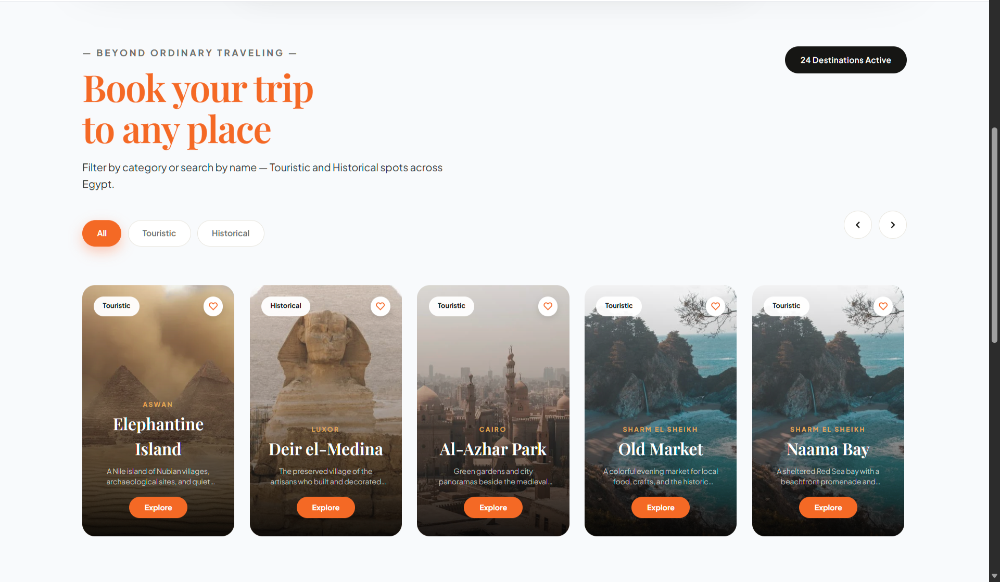
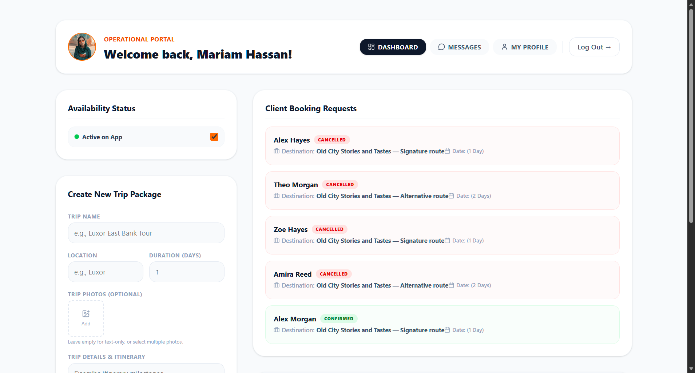

<p align="center">
  
</p>

<h1 align="center">Rafiq</h1>

<h3 align="center">
Your Intelligent Travel Companion for Exploring Egypt
</h3>

<p align="center">
Trip Planning • Verified Tour Guides • Smart Recommendations • Travel Safety • Cultural Experiences
</p>

<div align="center">


</div>

## What the project demonstrates

- Public discovery pages for Egyptian places and approved Tour Guide profiles.
- Tourist registration, profile completion, saved posts, bookings, and travel memories.
- Guide applications with a pending state and Admin approval before Guide tools unlock.
- Trip listings, Tourist-to-Guide bookings, reviews, and participant-scoped conversations.
- A curated day-by-day itinerary builder and a separate AI Place Finder that asks Groq to recommend places from the application’s own database.
- Admin pages for users, Guides, Places, reviews, reports, and chat monitoring.

Rafiq is a portfolio demo, not a booking marketplace with payments or live inventory. A booking is a status-tracked request; the data model does not include prices, payment capture, or chosen travel dates.

## User roles

| Role | Main capabilities |
| --- | --- |
| Visitor | Browse Places and approved Guides, open the AI Planner, register, and sign in. |
| Tourist | Manage a Tourist profile, share memories, book a Guide’s trip, review Places or Guides, and chat with a Guide. A Tourist needs a profile bio and location before creating a Memory. |
| Guide applicant | Submit a Guide profile for review. The account remains a Tourist until an Admin approves it. |
| Approved Guide | Manage a public Guide profile and trips, respond to bookings, and use the inbox. |
| Admin | Manage platform records and review Guide applications, content, reports, and chats. Admin access is provisioned separately from public registration. |

## Technology

- **Frontend:** React 19, Vite, React Router, TanStack Query, Tailwind CSS, Lucide and React Icons.
- **Backend:** Node.js, Express 5, Mongoose, MongoDB, JWT, and bcryptjs.
- **External services:** Cloudinary for user image uploads; Groq’s chat-completions API for AI Place recommendations.
- **Tests:** Node’s built-in test runner for backend controller, middleware, and access-control coverage. The frontend has ESLint and a Vite production build; it has no automated browser-test suite.

## Architecture



The frontend uses one authentication context. It keeps a bearer token in local or session storage, then asks `/api/users/me` for the current account and role. The backend verifies the token and loads the current role from MongoDB on protected routes; a stored role is never an authorization source.

## Repository map

```text
Client/                 React application, Vite config, public images and avatars
  src/App.jsx            Public and protected routes
  src/auth/              Shared frontend authentication state
  src/Features/chat/     Chat widget, Guide inbox, and React Query hooks
  src/Pages/             Home, planner, Tourist, Guide, and Admin pages
  src/services/          Authenticated fetch and API helpers
Server/                 Express API and database code
  App.js                 API setup, database readiness, middleware, route mounts
  Routes/                HTTP routes and role middleware
  Controllers/           Validation, ownership checks, and business rules
  Models/                Mongoose document schemas
  Services/              Cloudinary, AI recommendations, and chat identity
  tests/                 Backend automated tests
  scripts/               Demo seed, inspection, account check, and image import
  api/index.js             Serverless adapter for the Express app
  ```

## Local setup

Use Node.js 22 LTS and a reachable MongoDB instance. The Vite development server proxies `/api` to `http://localhost:5000` by default.

1. Copy `Server/.env.example` to `Server/.env` and set `MONGO_URI` and a private `JWT_SECRET` of at least 32 bytes. Add Groq or Cloudinary values only if you want those integrations.
2. In a terminal, install and start the API:

   ```powershell
   Set-Location Server
   npm install
   npm run dev
   ```

3. In a second terminal, copy `Client/.env.example` to `Client/.env`, then install and start the client:

   ```powershell
   Set-Location Client
   npm install
   npm run dev
   ```

4. Open the local URL printed by Vite. The API listens on port `5000` by default.

### Environment variables

| File | Variable | Purpose |
| --- | --- | --- |
| `Server/.env` | `MONGO_URI` | MongoDB connection string. |
| `Server/.env` | `JWT_SECRET` | Server-only signing key; at least 32 bytes. |
| `Server/.env` | `FRONTEND_ORIGINS` | Comma-separated browser origins allowed by CORS. Local Vite origins are the development default. |
| `Server/.env` | `GROQ_API_URL`, `GROQ_API_KEY`, `MODEL` | Optional AI Place Finder integration. |
| `Server/.env` | `CLOUDINARY_CLOUD_NAME`, `CLOUDINARY_API_KEY`, `CLOUDINARY_API_SECRET` | Optional server-side image upload and image importer. |
| `Client/.env` | `VITE_API_URL` | API base URL; `/api` uses the local Vite proxy. |
| `Client/.env` | `VITE_USE_MOCK_CHAT` | Set `true` only to intentionally display the chat hook’s mock data. |

The `.env.example` files contain placeholder values only. Never put real secrets in them.

## Portfolio deployment

The Vercel deployment serves the client and the API from the same origin; the client’s default `VITE_API_URL=/api` is correct for this setup. In Vercel, configure these **server-side** environment variables for the Production environment:

| Variable | Required | Notes |
| --- | --- | --- |
| `MONGO_URI` | Yes | Reachable MongoDB connection string; allow Vercel’s outbound connections in the database network settings. |
| `JWT_SECRET` | Yes | Private random value of at least 32 bytes. |
| `FRONTEND_ORIGINS` | Yes for browser access | Comma-separated exact browser origin(s), including the deployed HTTPS frontend origin (for example `https://your-project.vercel.app`); do not add a trailing slash. Include any custom domain used by the demo. |
| `CLOUDINARY_CLOUD_NAME`, `CLOUDINARY_API_KEY`, `CLOUDINARY_API_SECRET` | Only for image uploads | All three are needed for server-side uploads. |
| `GROQ_API_URL`, `GROQ_API_KEY`, `MODEL` | Only for AI recommendations | Configure all three to enable the AI Place Finder. |

Set the variables in Vercel’s project settings; do not commit them or put server secrets in `VITE_*` variables. Redeploy after changing them. If deploying the frontend separately from the API, set `VITE_API_URL` to the API’s `/api` base URL and configure that frontend’s exact origin in `FRONTEND_ORIGINS`. The repository’s local CORS defaults are for development and do not include a deployed domain.

Historical Git blobs include an old MongoDB URI credential in two `Server/.env` revisions and a non-placeholder `JWT_SECRET` in one. If those commits were pushed or otherwise shared, rotate/revoke the MongoDB database-user credential and replace the JWT secret before launch; replacing the JWT secret invalidates existing tokens. Their revocation status has not been verified. No Git history rewrite was performed.

## Demo data

Demo scripts use deterministic `demo.*@rafiq.test` accounts and upserts. The data seeder has a preflight guard for the original non-demo accounts and does not clear collections. It writes its generated shared demo password to the ignored local file `Server/.demo-credentials`; the image importer writes its reusable Cloudinary mapping to the ignored `Server/.demo-image-cache.json`.

Run these from `Server/` only after checking the configured database and the seeder’s preflight expectations:

```powershell
npm run seed:demo:inspect      # Read-only counts, relationships, and image health
npm run verify:demo:accounts  # Login and role smoke checks for the documented demo accounts
npm run seed:demo              # Idempotent demo-data upserts; do not point at an unreviewed database
npm run seed:demo:images       # Optional resumable Cloudinary import; reuses the ignored cache
```

The seed is not a database reset. It can update demo records, so inspect the database first and stop if the safety check reports unexpected accounts. The generated shared password stays in the ignored local file `Server/.demo-credentials`; no password is committed here.

## Tests and checks

```powershell
Set-Location Server
npm test

Set-Location ..\Client
npm run lint
npm run build
```

The backend suite uses `node --test`. Frontend linting and the production bundle are separate commands. Browser flows are currently checked manually; they are not automated in CI.

## Screenshots

The images below are **earlier UI design references**, not screenshots of the current application.

<p align="center">
  
  
</p>
<p align="center"><em>Home page and places explorer concepts</em></p>

<p align="center">
  
  
</p>
<p align="center"><em>Guide dashboard and trip-planning concepts</em></p>

## Meet the team

| Team member | Role |
| --- | --- |
| Gerges Naguib  | Frontend Developer |
| Eman Ashraf    | Full Stack Developer |
| Basmala Mohamed| Frontend Developer |
| Mahmoud Tamer  | Frontend Developer |
| Mehrael Nabil  | Frontend Developer |
| Kirolos Ayman  | Frontend Developer |

## Known limitations

- The day-by-day itinerary builder displays curated sample routes locally. The AI Place Finder below it is the part that calls Groq and matches interests against stored Places.
- Chat refreshes through polling; it does not use WebSockets or push delivery.
- Booking requests have status transitions but no payment processing, inventory, date calendar, or cancellation policy engine.
- JWTs are bearer tokens stored in browser-accessible storage. Logout clears the current browser token; the stateless API does not revoke an already issued token before its expiry.
- Authentication and AI rate limits are in-process per API instance. They are a useful demo guard, not a shared production quota service.
- The app has no automated browser-flow suite, and Admin UI access requires the original Admin account credentials.
- AI and user image uploads need external service credentials; public browsing and the curated itinerary builder do not.
